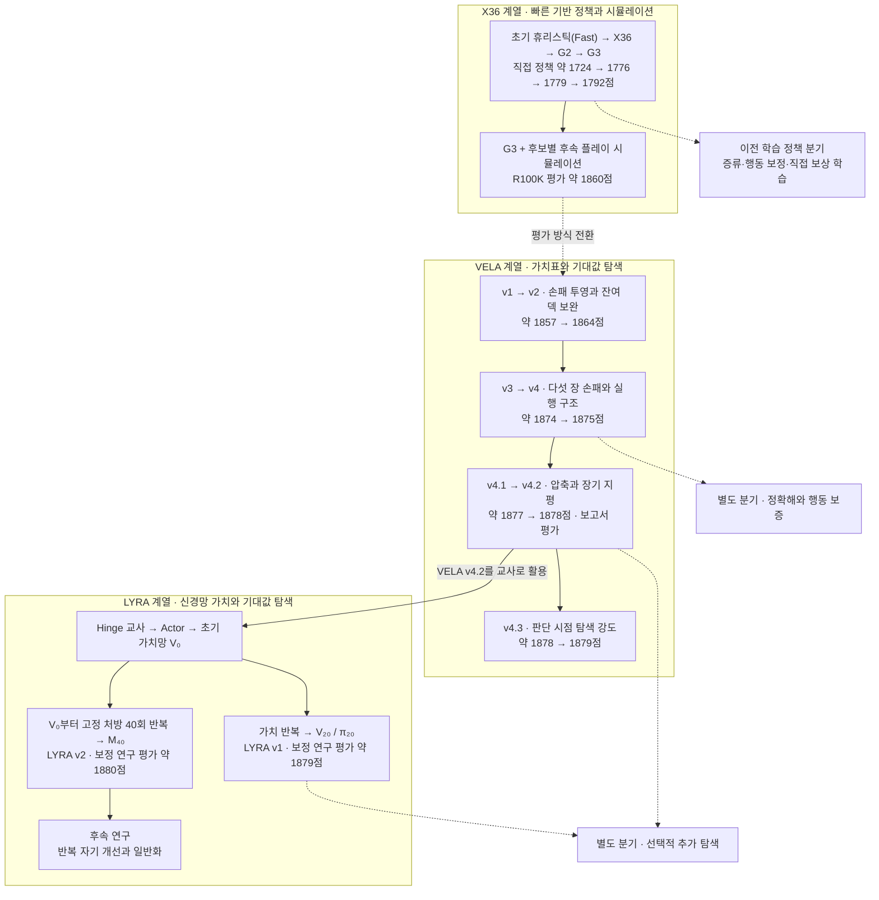

# Adventure 연구 계보

[English](README.md) | 한국어

Adventure의 행동 추천은 X36의 후속 게임 시뮬레이션, VELA의 사전 계산 가치표, LYRA의 신경망 가치 추정으로 발전했습니다. 이 문서는 각 전환의 배경과 평가 성능, 남은 연구 과제를 정리합니다.

| 보고 싶은 내용 | 안내 |
|---|---|
| 모델 생성·학습·변환 | [재현 가이드](reproduction/README.ko.md) |
| 유한 자원 MDP, 상태 공간과 Oracle 실험 | [환경과 계산량](topics/environment.md) |
| 실제 규칙으로 끝까지 푼 정확해(Q\*·V\*·a\*)와 탐색량 | [실제 게임 정확해](topics/exact-solutions.md) |
| X36의 형성, 가치표와 탐색의 발전 | [가치 표현과 탐색](topics/value-and-planning.md) |
| 과거 신경망 연구부터 LYRA의 학습 정체까지 | [학습과 정체](topics/learning-and-plateaus.md) |
| 점수·정확성·용어의 해석 | [평가와 공통 기준](topics/evaluation.md) |
| 보고서와 공통 연구 허브의 근거 | [출처와 확인 범위](topics/sources.md) |

## 한눈에 보는 흐름

실선은 계열 내부의 연구 전개와 표기된 교사 관계를, 점선은 접근 전환과 관련 연구를 나타냅니다. 점수는 평가별 대표값을 반올림했습니다. 가중치 계승 여부와 통계적 개선은 각 보고서의 비교 조건을 확인해야 합니다.

### 1. X36 — 빠른 판단을 많은 후속 플레이로 보완

초기 휴리스틱은 JavaScript의 `chooseAction()`으로 구현됐으며, 이후 엔진 선택 기능을 넣으면서 `chooseActionFast()`로 분리·조정됐습니다. Fast는 이 구현을 가리키는 평가용 이름입니다.

X36에서는 보드·카드·손패를 가중 평가하는 방식을 사용했고, G2의 종반 처리와 G3의 미래 카드 가치가 뒤따랐습니다. 서비스는 이 직접 정책을 시뮬레이션의 **후속 정책**으로 사용합니다. 첫 행동별로 끝까지 플레이한 결과를 비교하므로, 서비스의 추천 성능은 직접 정책 약 1792점과 구분해야 합니다.

과거 신경망 연구에서도 직접 정책의 점수 개선은 확인됐습니다. 다만 이 개선이 시뮬레이션 기반 추천으로 이어지는지, 반복 호출 비용을 감당할 수 있는지는 따로 검증해야 했습니다.

### 2. VELA v1–v3 — 더 충실한 가치 표현

VELA는 미리 계산한 상태 가치를 조회하고, 행동 결과의 확률에 따라 기대값을 계산합니다. v2에서는 잔여 덱의 장기 영향, v3에서는 다섯 장 손패의 상호작용을 더 충실하게 다뤘습니다. 각각의 대응 평가에서 개선이 확인됐습니다. v3의 온라인 탐색은 1-step으로 줄었습니다. 이 구간에서는 탐색 깊이보다 가치 표현의 변화가 두드러집니다.

### 3. VELA v4–v4.2 — 큰 가치표를 실행 가능한 모델로

손패와 지평을 늘리면 가치표의 크기도 커집니다. v4는 보존된 H24 체크포인트와 시간 보정으로 실행 구조를 만들었고, v4.1은 FULL48을 공유 구조로 압축했습니다. v4.2는 horizon 100의 가치를 Hinge 학습으로 압축했습니다. 모델 크기와 판단 시간을 줄이면서 가치를 얼마나 보존하는지가 이 구간의 주요 과제였습니다. 원본 정책 대비 점수 개선과 서비스 사용 가능성은 각각 평가했습니다.

### 4. LYRA v1 — 가치표에서 학습 기반 가치로

LYRA 연구는 모델이 플레이하며 모은 자료로 다음 모델을 학습하는 반복 자기 개선을 목표로 삼았습니다. 초기에는 VELA v4.2를 모방한 정책에 PPO를 적용했으나 원하는 개선을 얻지 못했습니다. 이후 신경망의 다음 상태 가치와 실제 덱 전이를 결합하는 가치 반복으로 전환했습니다. **LYRA v1은 V₂₀ 가치망과 π₂₀ 1-step 정책**입니다. 과거 QStar의 `v20`은 별도 연구 번호입니다.

### 5. LYRA v2 — 같은 정책, 더 큰 가치망

LYRA v2는 v1과 같은 1-step 정책에 15.4M 가치망 **M₄₀**을 씁니다. V₂₀을 이어 학습하지 않고, 더 큰 가치망을 V₀부터 하나의 고정 처방으로 40회 반복 학습했습니다. 새 시드 10K쌍의 봉인 평가에서 π₂₀보다 +1.00점(동시 CI [0.53, 1.46]) 높았고, 배포 정밀도(FP32) 확인 평가에서도 +1.08점이었습니다. 학습 시드를 바꾼 반복에서도 같은 크기의 이득이 재현됐지만, 61M에서는 더 오르지 않았습니다. [LYRA v2 보고서](lyra-v2/report-ko.md)

### 6. 후속 연구 — 더 잘 맞추는 것과 더 잘 고르는 것의 차이

π₂₀ 이후에는 학습 손실이나 일부 가치 오차를 줄여도 게임 점수가 개선되지 않는 정체가 반복됐습니다. 초기에는 반복 갱신으로 얻는 개선분을 증류 과정의 근사 오차가 상쇄하는 것으로 보였습니다. 이후 행동 변화를 분해한 사후 진단에서는 잘못된 선택을 고치는 이득과 기존의 좋은 선택을 손상시키는 손실이 함께 생기는 양상이 관측됐습니다.

추가 탐색은 개선을 만들지만, 그 이득을 저렴한 1-step 가치망으로 옮기는 일은 어렵습니다. 후속 연구에서는 표현·학습 분포·모델 규모가 반복 개선의 정체를 바꾸는지 비교합니다. 그중 같은 처방으로 V₀부터 반복한 15.4M 모델이 LYRA v2가 됐습니다. [후속 연구 질문](topics/learning-and-plateaus.md#후속-연구-질문)에 설계와 확인 범위를 정리했습니다.

### 7. VELA v4.3 — 같은 가치표, 더 깊은 판단

v4.3은 v4.2의 가치 모델을 그대로 두고 판단 시점의 계산량을 탐색 강도로 나눴습니다. 2-step 결과를 한 단계 더 깊게 보정하고, 상위 행동이 접전이면 최대 6-step까지 분기를 확장합니다. 서로 다른 두 시드 집합의 20K쌍에서 보통·높음·최고 단계가 v4.2 대비 각각 +1.41, +2.10, +2.65점이었고, 이웃 단계 사이의 차이도 모두 확인됐습니다. 개선의 절반 이상은 가장 작은 예산에서 나옵니다. [보고서](vela-v4.3/report-ko.md)에 탐색 방식과 채택하지 않은 변형을 정리했습니다.

## 주요 지점의 연구 평가

아래 수치는 고정된 정책을 평가한 기록입니다. 평가 시드 집합·표본 수·통계 보정 여부가 달라 서비스 선택창의 대표값(X36 약 1860, VELA 약 1877, LYRA v1 약 1879, LYRA v2 약 1880)과 차이가 있습니다. 개선량은 같은 조건에서 비교한 결과를 기준으로 읽어야 합니다.

| 지점 | 평균 점수 | 평가·해석 | 근거 |
|---|---:|---|---|
| 초기 X36 / G2 / G3 직접 정책 | 1776.42 / 1779.30 / 1791.76 | 각각 공통 조건 10M판. 서비스의 root 추천 점수와 다름 | [과거 평가](topics/value-and-planning.md#x36-계열의-두-층) |
| G3 기반 R100K | 1860.11 | 보관 512판, 평균 CI [1842.29, 1877.94] | [과거 평가](topics/value-and-planning.md#x36-계열의-두-층) |
| VELA v1 | 1857.11013 | 독립 100K판 | [보고서](vela-v1/report-ko.md) |
| VELA v2 | 1863.96061 | 같은 평가 시드의 v1 대비 +6.20234, CI [4.85477, 7.54991] | [보고서](vela-v2/report-ko.md) |
| VELA v3 | 1873.62695 | 같은 평가 시드의 v2 대비 +9.80262, CI [8.28441, 11.32083] | [보고서](vela-v3/report-ko.md) |
| VELA v4 | 1874.83320 | 독립 50K판. v3보다 평균은 높지만 통계적 우위는 미확인 | [보고서](vela-v4/report-ko.md) |
| VELA v4.1 / COMPACT48 | 1876.5108 | 독립 90K쌍. FULL48 대비 -1.5740, 원 연구 비열등성 기준 미충족 | [보고서](vela-v4.1/report-ko.md) |
| VELA v4.2 / Hinge | 1878.13502 | 동결 100K판. FULL100 대비 +0.09784, CI [-1.04640, 1.24208]로 우위 미확인 | [보고서](vela-v4.2/report-ko.md#3-평가-결과) |
| VELA v4.3 / 탐색 강도 | 1878.59 / 1879.28 / 1879.83 | 보통 / 높음 / 최고. 두 시드 집합 20K쌍 보정 평균, v4.2 대비 +1.41 / +2.10 / +2.65 | [보고서](vela-v4.3/report-ko.md) |
| LYRA v1 / π₂₀ | 약 1879 | 제어변량 보정 대표값. v4.2 대비 +1.30 / +1.49, 서로 다른 평가 시드 집합에서 각각 10K쌍 | [보고서](lyra-v1/report-ko.md) |
| LYRA v2 / M₄₀ | 약 1880 | 제어변량 보정 대표값. 새 시드 봉인 10K쌍에서 π₂₀ 대비 +1.00, 동시 CI [0.53, 1.46]. FP32 확인 10K쌍 +1.08 | [보고서](lyra-v2/report-ko.md) |

CI는 추정 불확실성을 나타내는 신뢰구간입니다. [평가 기준](topics/evaluation.md)에서 원점수·보정 점수와 비교 방법을 설명합니다.

## 이름의 유래

VELA와 LYRA의 이름은 그리스 신화 속 이아손과 아르고 원정대의 황금양털 원정에서 영감을 받았습니다. 별자리 이름과 원정에 얽힌 상징을 통해 출항에서 여정, 성취로 이어지는 연구의 방향을 담았습니다.

**VELA**는 옛 아르고호자리의 돛 부분을 이어받은 돛자리에서 따왔습니다. 미지의 세계를 향해 돛을 올리는 모습은 새로운 가능성을 탐색하고 해결책을 찾아가는 태도를 상징합니다. 이 명명 체계에서 VELA는 더 나은 판단 방법을 찾아 나서는 출항에 해당합니다.

**LYRA**는 원정대원 오르페우스의 리라와 연결되는 거문고자리에서 따왔습니다. 음악으로 원정대의 항해를 도운 오르페우스에게서 여정과 조화의 의미를 가져왔으며, 경험을 통해 판단을 다듬는 지속적인 개선을 상징합니다. 실제 연구도 VELA를 교사로 삼아 학습을 시작한 뒤, 모델이 수집한 경험과 새로 계산한 학습 정답으로 다음 모델을 개선하는 반복 자기 개선을 목표로 삼았습니다.

후속 이름 후보인 **ARIES**는 황금양털을 지닌 숫양과 연결되는 양자리에서 따왔습니다. 원정대가 찾아 나선 황금양털에서 성취의 의미를 가져왔습니다. 이 이름은 전역 최적성이 수학적으로 증명되었거나, 전역 최적해와의 오차가 매우 작음을 입증한 모델 또는 정책을 위해 남겨 둔 후보입니다.

## 다음으로 읽기

- **재현:** [전체 가이드](reproduction/README.ko.md). 모델별 보고서: [VELA v4.2](vela-v4.2/report-ko.md), [VELA v4.3](vela-v4.3/report-ko.md), [LYRA v1](lyra-v1/report-ko.md), [LYRA v2](lyra-v2/report-ko.md).
- **세부 연구:** [가치·탐색과 별도 분기](topics/value-and-planning.md), [학습 성과·정체·열린 질문](topics/learning-and-plateaus.md).
- **공통 기준:** [환경·상태 공간·Oracle 실험](topics/environment.md), [상태·정책·평가와 용어](topics/evaluation.md), [출처·근거의 범위](topics/sources.md).
