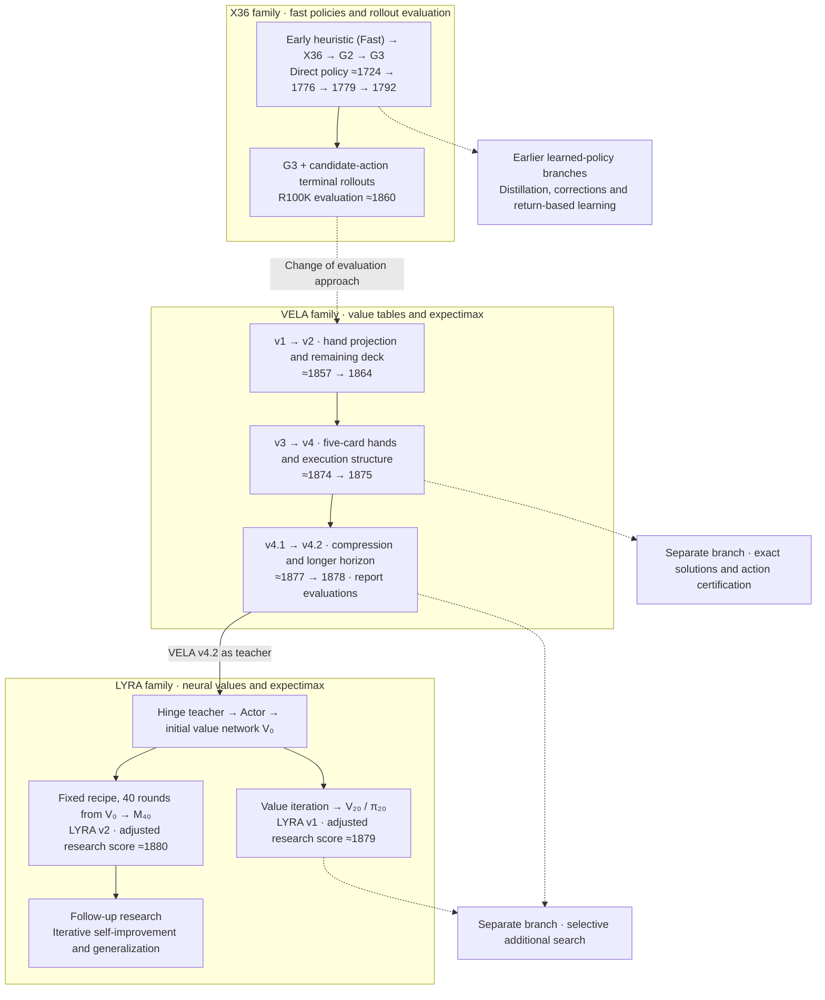

# Adventure Research Lineage

English | [한국어](README.ko.md)

Adventure action recommendations evolved from X36 terminal rollouts to VELA value tables and LYRA neural values. This overview explains the reasons for each change, the reported performance, and the remaining research questions.

| Read about | Guide |
|---|---|
| Generation, training and conversion | [Reproduction guide](reproduction/README.md) |
| Finite-resource MDP, state space and oracle experiments | [Environment and computational cost — Korean](topics/environment.md) |
| Exact solutions under the real rules (Q\*, V\*, a\*) and search cost | [Exact solutions — Korean](topics/exact-solutions.md) |
| X36, value tables and planning | [Value representation and planning — Korean](topics/value-and-planning.md) |
| Earlier neural branches and LYRA's plateau | [Learning and plateaus — Korean](topics/learning-and-plateaus.md) |
| Scores, evidence and terminology | [Evaluation and shared criteria — Korean](topics/evaluation.md) |
| Reports and shared-hub evidence | [Sources and scope — Korean](topics/sources.md) |

## At a glance

Solid arrows show development within a family and the labeled teacher relationship; dotted arrows mark changes of approach and related work. Scores are rounded from evaluations with different conditions. Checkpoint inheritance and performance gains require the evidence in each report.

## The major transitions

### 1. X36: improve a fast policy with terminal rollouts

The initial heuristic was implemented as `chooseAction()`. It was later split into `chooseActionFast()` and adjusted when the engine selector was introduced. Fast is the evaluation label for that implementation.

X36 used a weighted board/card/hand scorer, followed by G2's revised late-game terms and G3's future-card term. The service uses the direct policy as a **continuation policy**: fix each candidate first action, simulate to termination, and compare final scores. Its recommendation score therefore differs from the ≈1792-point direct G3 score.

Some earlier learned policies improved direct play. They still required separate tests of recommendation quality and the cost of running the model at every simulated decision.

### 2. VELA v1–v3: represent more of the state's value

VELA moved to precomputed values and probability-weighted action outcomes. v2 strengthened remaining-deck effects; v3 directly represented five-card hand interactions. Both improved their paired baselines, even though v3 reduced online search to 1-step.

### 3. VELA v4–v4.2: make large value tables usable

Representing larger hands and longer horizons requires larger tables. v4 combined retained H24 values with a time correction; v4.1 compressed FULL48 with a shared structure; v4.2 compressed horizon-100 values using Hinge training. These changes addressed model size and decision latency while preserving useful values. Score improvements over the original policy and suitability for service use were evaluated separately.

### 4. LYRA v1: learn a value representation

LYRA aimed to build an iterative self-improvement loop: collect games with a model, train its successor, and repeat. It began with VELA v4.2 imitation followed by PPO, which did not deliver the desired improvement. The research then moved to value iteration using neural child-state values and exact expectations over actual-deck transitions. **LYRA v1 is the V₂₀ value network with the π₂₀ 1-step policy.** The older QStar `v20` is a separate research version.

### 5. LYRA v2: same policy, larger value network

LYRA v2 uses the same 1-step policy with the 15.4M value network **M₄₀**. Instead of continuing from V₂₀, the larger network was trained from V₀ for 40 rounds with one fixed recipe. In a sealed evaluation on 10K new seed pairs it scored +1.00 points above π₂₀ (simultaneous CI [0.53, 1.46]), and +1.08 in a confirmation at deployment precision (FP32). The scale gain over 5.5M replicated with a second training seed, but a 61M model did not improve further. [LYRA v2 report (Korean)](lyra-v2/report-ko.md)

### 6. Follow-up: better prediction is not always better control

After π₂₀, lower training loss or value error often failed to improve game score. Early analyses suggested that approximation error introduced during distillation was offsetting the gains from iterative updates. Later post-hoc analyses of changed actions found gains from correcting poor choices alongside losses from damaging previously good choices.

Additional search delivers gains, but transferring them into an inexpensive 1-step value network remains difficult. Follow-up studies test whether representation, training distribution and model scale change the plateau under iterative updates. The 15.4M model iterated from V₀ with one fixed recipe became LYRA v2. See [the learning discussion](topics/learning-and-plateaus.md#후속-연구-질문) for the designs and evidence limits.

## Representative research evaluations

These evaluations used fixed policies. Seed sets, sample sizes and statistical adjustments differ, so individual report means can differ from the service references (X36 ≈1860, VELA ≈1877, LYRA v1 ≈1879, LYRA v2 ≈1880). Read each improvement claim within its stated comparison.

| Milestone | Mean score | Evaluation and interpretation | Evidence |
|---|---:|---|---|
| Early X36 / G2 / G3, direct | 1776.42 / 1779.30 / 1791.76 | 10M episodes each under common evaluation conditions; not root-engine scores | [Historical evaluation](topics/value-and-planning.md#x36-계열의-두-층) |
| G3-based R100K | 1860.11 | Archived 512 episodes; mean CI [1842.29, 1877.94] | [Historical evaluation](topics/value-and-planning.md#x36-계열의-두-층) |
| VELA v1 | 1857.11013 | Independent 100K episodes | [Report](vela-v1/report-ko.md) |
| VELA v2 | 1863.96061 | Paired v1 delta +6.20234, CI [4.85477, 7.54991] | [Report](vela-v2/report-ko.md) |
| VELA v3 | 1873.62695 | Paired v2 delta +9.80262, CI [8.28441, 11.32083] | [Report](vela-v3/report-ko.md) |
| VELA v4 | 1874.83320 | Independent 50K; a higher point estimate does not establish superiority to v3 | [Report](vela-v4/report-ko.md) |
| VELA v4.1 / COMPACT48 | 1876.5108 | Independent 90K pairs; FULL48 delta -1.5740; original noninferiority gate not met | [Report](vela-v4.1/report-ko.md) |
| VELA v4.2 / Hinge | 1878.13502 | Frozen 100K; FULL100 delta +0.09784, CI [-1.04640, 1.24208]; superiority not established | [Report](vela-v4.2/report-ko.md#3-평가-결과) |
| LYRA v1 / π₂₀ | ≈1879 | Control-variate-adjusted reference; v4.2 deltas +1.30 / +1.49 in separate sets of 10K episode pairs | [Report](lyra-v1/report-ko.md) |
| LYRA v2 / M₄₀ | ≈1880 | Control-variate-adjusted reference; sealed 10K new-seed pairs: +1.00 vs π₂₀, simultaneous CI [0.53, 1.46]; FP32 confirmation on 10K pairs: +1.08 | [Report](lyra-v2/report-ko.md) |

CI denotes a confidence interval. The [evaluation guide](topics/evaluation.md) explains raw and adjusted scores and how the comparisons were made.

## Naming

VELA and LYRA take their names from the story of Jason and the Argonauts' quest for the Golden Fleece in Greek mythology. The constellation names and their connections to the expedition give the research a shared narrative: departure, journey and achievement.

**VELA** comes from the Sails, one of the constellations formed from the former Argo Navis constellation. Raising the sails for an unfamiliar voyage symbolizes exploring possibilities and seeking solutions. Within this naming scheme, VELA marks the departure: setting out to find better ways to make decisions.

**LYRA** comes from the constellation associated with the lyre of Orpheus, a member of the Argonauts whose music helped the expedition on its voyage. It symbolizes the journey and harmony, with an emphasis on refining decisions through experience. The research began with VELA as a teacher, then pursued iterative self-improvement: using experience collected by a model and newly computed training targets to improve its successor.

**ARIES**, a candidate name for a future model, comes from the constellation associated with the ram that bore the Golden Fleece. The expedition's pursuit of the fleece gives the name its meaning of achievement. It is reserved for a model or policy with mathematically proven global optimality, or a demonstrated very small error relative to the global optimum.

## Continue reading

- **Reproduce:** [guide](reproduction/README.md). Model reports (Korean): [VELA v4.2](vela-v4.2/report-ko.md), [LYRA v1](lyra-v1/report-ko.md), [LYRA v2](lyra-v2/report-ko.md).
- **Research detail:** [values and search](topics/value-and-planning.md), [learning and plateaus](topics/learning-and-plateaus.md).
- **Shared foundations:** [environment, state space and oracle experiments — Korean](topics/environment.md), [state definitions, policies and evaluation criteria](topics/evaluation.md), [sources and evidence limits](topics/sources.md).
